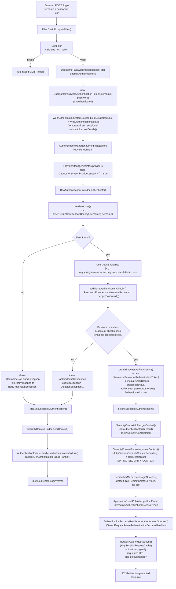
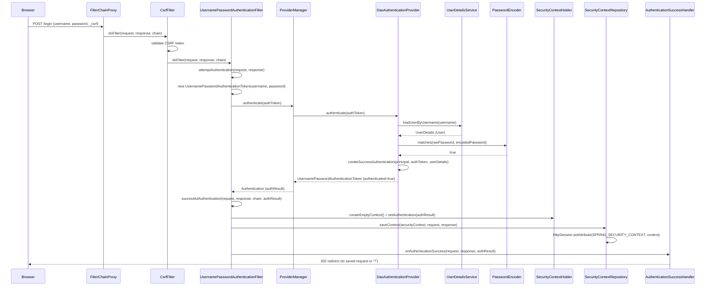

# Spring Security — Login Flow Architecture (Zero Java/XML Configuration)

Scope: Spring Boot 3.x + Spring Security 6.x, with **only** `spring-boot-starter-security` on
the classpath — no `SecurityFilterChain` bean, no `WebSecurityConfigurerAdapter` (removed
anyway), no `application.properties` overrides. This is the "just add the starter jar" case,
using the **default form-login page**.

---

## 1. What auto-configuration wires up for you

| Auto-config class | What it registers |
|---|---|
| `SecurityAutoConfiguration` | Bootstraps `SpringBootWebSecurityConfiguration`, imports `AuthenticationEventPublisher` bean (`DefaultAuthenticationEventPublisher`) |
| `SpringBootWebSecurityConfiguration` | Supplies the **default `SecurityFilterChain` bean** (`defaultSecurityFilterChain(HttpSecurity http)`) if you didn't define one — it calls `http.authorizeHttpRequests(a -> a.anyRequest().authenticated())`, `http.formLogin(withDefaults())`, `http.httpBasic(withDefaults())` |
| `UserDetailsServiceAutoConfiguration` | Creates a single in-memory user (`username=user`, random UUID password) if no `UserDetailsService`/`UserDetailsManager`/`AuthenticationManager`/`AuthenticationProvider` bean exists. Password is printed to the console log. |
| `SecurityFilterAutoConfiguration` | Registers `DelegatingFilterProxyRegistrationBean` for the bean named `springSecurityFilterChain`, i.e. wires `FilterChainProxy` into the Servlet container as a single `Filter`. |

**Key infrastructure objects created at startup:**

| Object | Type | Purpose |
|---|---|---|
| `springSecurityFilterChain` | `FilterChainProxy` | The one real `javax.servlet.Filter` the container knows about; delegates to a list of `SecurityFilterChain`s |
| default `SecurityFilterChain` | `DefaultSecurityFilterChain` | Ordered `List<Filter>` matched against every request (`AnyRequestMatcher`) |
| default user store | `InMemoryUserDetailsManager` | Holds one `User` (implements `UserDetails`) — username `user`, a generated password, authority `ROLE_USER` |
| password encoder | `DelegatingPasswordEncoder` (from `PasswordEncoderFactories.createDelegatingPasswordEncoder()`) | Encodes/matches passwords, prefix `{bcrypt}` by default |
| `AuthenticationManager` | `ProviderManager` | Holds `List<AuthenticationProvider>` → in this setup, one `DaoAuthenticationProvider` |

---

## 2. Default filter chain (order matters)

```
FilterChainProxy
 └─ DefaultSecurityFilterChain (matches "/**")
     1. DisableEncodeUrlFilter
     2. WebAsyncManagerIntegrationFilter
     3. SecurityContextHolderFilter                 (loads SecurityContext for the request)
     4. HeaderWriterFilter                          (writes security headers e.g. X-Content-Type-Options)
     5. CsrfFilter                                  (validates CSRF token on state-changing requests)
     6. LogoutFilter
     7. UsernamePasswordAuthenticationFilter         ← handles POST /login
     8. DefaultLoginPageGeneratingFilter             (serves GET /login HTML when no custom page)
     9. DefaultLogoutPageGeneratingFilter
    10. BasicAuthenticationFilter
    11. RequestCacheAwareFilter
    12. SecurityContextHolderAwareRequestFilter
    13. AnonymousAuthenticationFilter
    14. SessionManagementFilter
    15. ExceptionTranslationFilter
    16. AuthorizationFilter                          (final authorize decision, replaces FilterSecurityInterceptor)
```

---

## 3. Flow diagram — what happens when the login form is submitted (`POST /login`)



---

## 4. Sequence diagram — object collaboration



---

## 5. Class → key method reference table

| Class | Key method(s) | Role |
|---|---|---|
| `FilterChainProxy` | `doFilter()` | Entry point registered as the servlet `Filter`; picks the matching `SecurityFilterChain` |
| `UsernamePasswordAuthenticationFilter` (extends `AbstractAuthenticationProcessingFilter`) | `attemptAuthentication()`, `successfulAuthentication()`, `unsuccessfulAuthentication()` | Reads `username`/`password` params from `POST /login`, builds the token, delegates to `AuthenticationManager` |
| `ProviderManager` (implements `AuthenticationManager`) | `authenticate(Authentication)` | Iterates configured `AuthenticationProvider`s, returns first non-null successful result |
| `DaoAuthenticationProvider` (extends `AbstractUserDetailsAuthenticationProvider`) | `authenticate()`, `retrieveUser()`, `additionalAuthenticationChecks()`, `createSuccessAuthentication()` | Loads user + verifies password |
| `InMemoryUserDetailsManager` (implements `UserDetailsService`, `UserDetailsManager`) | `loadUserByUsername(String)` | Default zero-config user store (single `user` account) |
| `DelegatingPasswordEncoder` (implements `PasswordEncoder`) | `matches(CharSequence, String)` | Verifies raw password against the `{id}hash` encoded value |
| `SecurityContextHolder` | `getContext()`, `setContext()`, `clearContext()` | Static holder (ThreadLocal by default) for the current `SecurityContext` |
| `SecurityContextHolderFilter` / `HttpSessionSecurityContextRepository` | `loadContext()`, `saveContext()` | Persists `SecurityContext` into `HttpSession` between requests |
| `SavedRequestAwareAuthenticationSuccessHandler` (implements `AuthenticationSuccessHandler`) | `onAuthenticationSuccess()` | Redirects to the originally requested protected URL (or default `/`) after login |
| `SimpleUrlAuthenticationFailureHandler` (implements `AuthenticationFailureHandler`) | `onAuthenticationFailure()` | Redirects to `/login?error` |
| `HttpSessionRequestCache` (implements `RequestCache`) | `saveRequest()`, `getRequest()` | Remembers the URL the anonymous user originally asked for before being redirected to `/login` |
| `DefaultLoginPageGeneratingFilter` | `generateLoginPageHtml()` | Serves the built-in HTML login form on `GET /login` when no custom page is configured |
| `ExceptionTranslationFilter` | `handleSpringSecurityException()` | Catches `AuthenticationException`/`AccessDeniedException`, triggers `AuthenticationEntryPoint` (redirect to `/login`) |
| `AuthorizationFilter` | `doFilter()` | Final gate — consults `AuthorizationManager` (`authorizeHttpRequests` rule) before letting the request reach the controller |

---

## 6. "Most common objects" created per login POST — quick recall list

1. `UsernamePasswordAuthenticationToken` — **unauthenticated** (principal = raw username string, credentials = raw password string)
2. `WebAuthenticationDetails` — remote IP + session id, attached via `token.setDetails(...)`
3. `UserDetails` (concrete: `org.springframework.security.core.userdetails.User`) — returned by `UserDetailsService`
4. `SimpleGrantedAuthority` (e.g. `ROLE_USER`) — inside the `UserDetails`/final `Authentication`
5. `UsernamePasswordAuthenticationToken` — **authenticated** (principal = `UserDetails`, credentials erased/null, authorities populated) — this is a *second, different* object from #1
6. `SecurityContextImpl` — wraps the authenticated `Authentication`, becomes `SecurityContextHolder`'s current context
7. `HttpSession` attribute `SPRING_SECURITY_CONTEXT` — where the `SecurityContext` is persisted for subsequent requests
8. `InteractiveAuthenticationSuccessEvent` — published on the `ApplicationEventPublisher`
9. `DefaultSavedRequest` — captured earlier (when the anonymous user first hit a protected URL and got bounced to `/login`), consumed by the success handler to redirect back
10. On failure: `BadCredentialsException` / `UsernameNotFoundException` (internally normalized so user enumeration isn't possible) → stored transiently, drives the `/login?error` redirect

---

## 7. Notes specific to "zero configuration"

- There is exactly **one** `AuthenticationProvider` (`DaoAuthenticationProvider`) because there's exactly one credential source (the generated in-memory user).
- The generated password is logged once at startup: `Using generated security password: <uuid>`. It changes every restart — not usable for anything but local testing.
- CSRF protection is **on by default** for the default filter chain, so the built-in login form always includes a hidden `_csrf` field; a hand-rolled `POST /login` without it gets `403`.
- Because no `SecurityFilterChain` bean exists, Spring Boot's fallback (`SpringBootWebSecurityConfiguration.defaultSecurityFilterChain`) is what actually runs — "zero config" still means Spring Boot itself supplies a config, just not one you wrote.
- Session is created **lazily** — `HttpSessionSecurityContextRepository` only forces session creation once authentication succeeds and the context needs to be saved (default `SessionCreationPolicy.IF_REQUIRED`).
