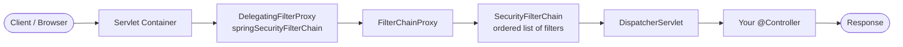
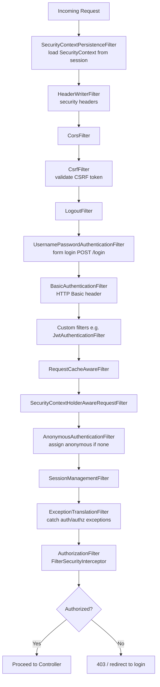
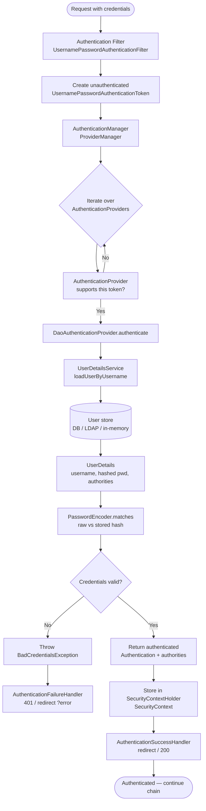
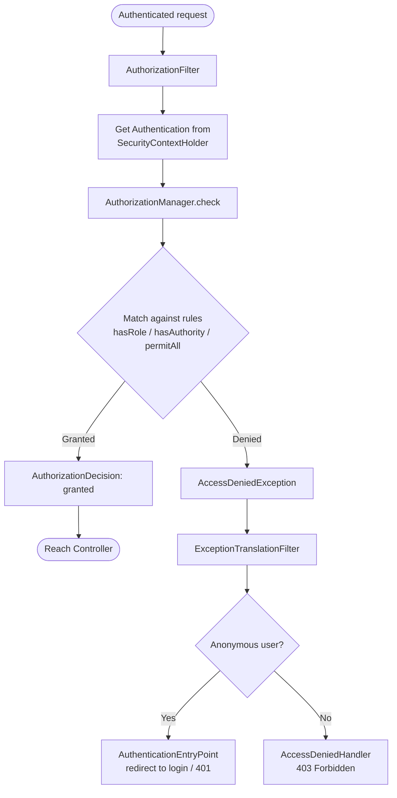
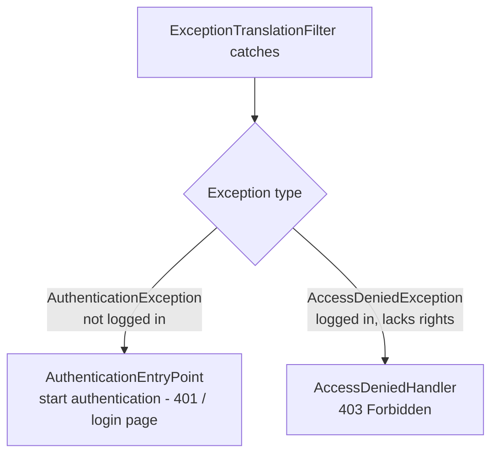
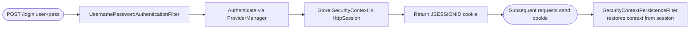
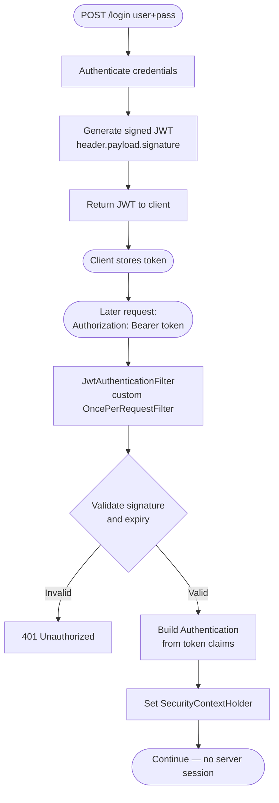
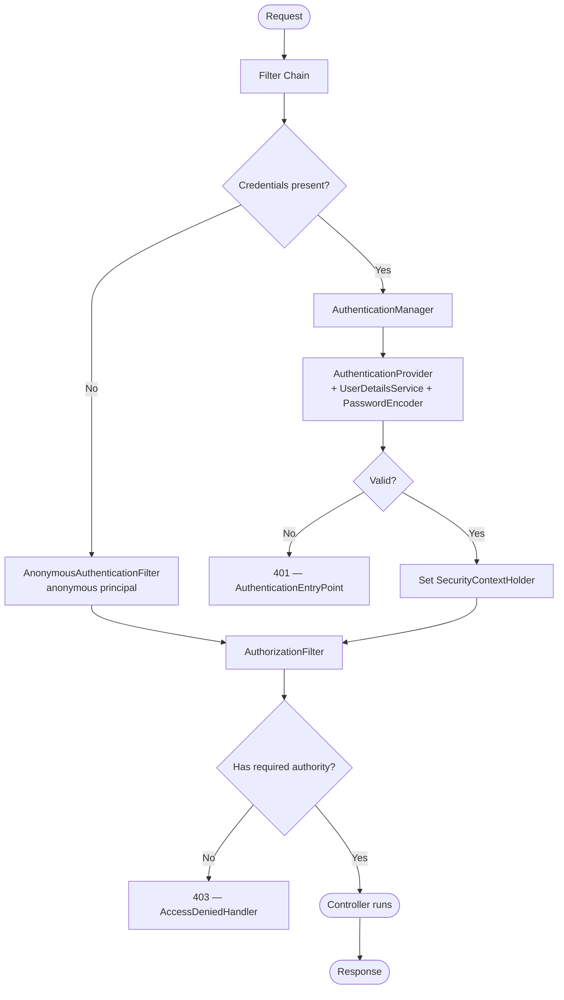

# Spring Security — Complete Flowchart

A step-by-step map of how a request flows through Spring Security: from the
Servlet container, through the filter chain, into authentication, then
authorization, and finally to your controller. All diagrams use
[Mermaid](https://mermaid.js.org/) and render directly on GitHub.

---

## 1. Big Picture — Where Spring Security Sits

Spring Security is a **chain of Servlet Filters** inserted in front of your
application by a single `DelegatingFilterProxy` registered in the container.



- **DelegatingFilterProxy** — a standard Servlet filter that delegates to a
  Spring-managed bean (`FilterChainProxy`), bridging the container and the
  Spring context.
- **FilterChainProxy** — picks the matching `SecurityFilterChain` (you can have
  several, matched by URL) and runs its filters in order.
- If all security filters pass, the request reaches the `DispatcherServlet`
  and your controller.

---

## 2. The Security Filter Chain (Order Matters)

Each filter has one job. The request passes through them in a fixed order.



> **Tip:** run with `logging.level.org.springframework.security=DEBUG` to see
> the exact filter list for your app at startup.

---

## 3. Authentication Flow (The Core)

This is the heart of it. When a request carries credentials, an
**authentication filter** builds an `Authentication` token and hands it to the
`AuthenticationManager`.



### Key contracts in this flow

| Component | Responsibility |
|---|---|
| `Authentication` | Holds the principal, credentials, and authorities. Starts *unauthenticated*, ends *authenticated*. |
| `AuthenticationManager` | Entry point. Usually `ProviderManager`. |
| `ProviderManager` | Delegates to a list of `AuthenticationProvider`s until one succeeds. |
| `AuthenticationProvider` | Does the actual check. `DaoAuthenticationProvider` is the common one. |
| `UserDetailsService` | Loads user data by username (`loadUserByUsername`). |
| `UserDetails` | The loaded user: username, encoded password, authorities, account flags. |
| `PasswordEncoder` | Verifies raw password against the stored hash (e.g. BCrypt). |
| `SecurityContextHolder` | Thread-local holder of the current `SecurityContext` (the authenticated principal). |

---

## 4. Authorization Flow

Once authenticated, Spring Security decides **what the user is allowed to do**.



- **Authentication** = *who are you?* → **Authorization** = *what can you do?*
- Rules come from your `SecurityFilterChain` config (`requestMatchers(...).hasRole(...)`)
  and/or method security (`@PreAuthorize`, `@Secured`).

---

## 5. Exception Handling Distinction

A frequent point of confusion — the `ExceptionTranslationFilter` routes two
different failures to two different handlers:



---

## 6. Form Login vs Stateless JWT

The two most common setups differ in **how state is carried between requests**.

### 6a. Session-based Form Login (stateful)



### 6b. Stateless JWT (token-based)



| Aspect | Form Login (session) | JWT (stateless) |
|---|---|---|
| Server state | `HttpSession` stores context | None — token is self-contained |
| Carried by | `JSESSIONID` cookie | `Authorization: Bearer` header |
| Scaling | Needs sticky sessions / shared store | Scales freely |
| Revocation | Invalidate session | Harder — needs blocklist / short expiry |
| CSRF | Relevant (cookie-based) | Usually disabled (header-based) |

---

## 7. End-to-End Summary (One Diagram)



---

## 8. Minimal Reference Configuration

```java
@Configuration
@EnableWebSecurity
public class SecurityConfig {

    @Bean
    SecurityFilterChain filterChain(HttpSecurity http) throws Exception {
        http
            .authorizeHttpRequests(auth -> auth
                .requestMatchers("/public/**").permitAll()
                .requestMatchers("/admin/**").hasRole("ADMIN")
                .anyRequest().authenticated()
            )
            .formLogin(Customizer.withDefaults());   // or .httpBasic(...)
        return http.build();
    }

    @Bean
    UserDetailsService users() {
        UserDetails user = User.withUsername("user")
            .password("{bcrypt}$2a$10$...")   // encoded
            .roles("USER")
            .build();
        return new InMemoryUserDetailsManager(user);
    }

    @Bean
    PasswordEncoder passwordEncoder() {
        return new BCryptPasswordEncoder();
    }
}
```

---

## Glossary (Quick Recall)

- **Principal** — the authenticated entity (usually the user).
- **Authority / Role** — a permission granted to the principal (`ROLE_ADMIN`, `READ`).
- **GrantedAuthority** — Spring's representation of an authority.
- **SecurityContext** — holds the current `Authentication`.
- **SecurityContextHolder** — thread-local access to the `SecurityContext`.
- **AuthenticationEntryPoint** — kicks off authentication when an anonymous user hits a protected resource.
- **OncePerRequestFilter** — base class for custom filters (e.g. JWT) guaranteed to run once per request.
